<!-- Banner -->

  

  
  
  

## About me

Advanced Computer Engineering student. I worked in IT as **Field Support**, providing technical support across different areas. Now I'm making the move into **software development**, the field I'm passionate about and where I've been actively training.

- 🎮 **Currently:** learning game development with a personal project in Godot.
- 🤝 **Open to:** job opportunities, collaborations, freelance work and mentorship — or just learning together.
- 🌐 **Languages:** Spanish (native) · English (advanced).

<b>🇺🇾 Leer en español</b>

 

Estudiante avanzado de Ingeniería en Computación. Trabajé en el sector IT como **Field Support**, brindando soporte técnico en diferentes áreas. Hoy busco dar el salto y orientar mi carrera hacia el **desarrollo**, área que me apasiona y donde vengo formándome activamente.

- **Ahora:** aprendiendo a desarrollar videojuegos con un proyecto personal en Godot.
- **Busco:** empleo, colaboraciones, freelance y mentoría — o simplemente seguir aprendiendo.
- **Idiomas:** español (nativo) · inglés (avanzado).

## Tech stack

  <picture>
    <source media="(prefers-color-scheme: dark)" srcset="https://skillicons.dev/icons?i=ts,js,html,css,py,java,cpp,godot&theme=dark&perline=8" />
    
  </picture>
   
  <picture>
    <source media="(prefers-color-scheme: dark)" srcset="https://skillicons.dev/icons?i=sass,tailwind,vscode,git,github,vercel&theme=dark&perline=8" />
    
  </picture>

  
  
  

## Featured projects

| Project | Description | Stack |
| :-- | :-- | :-- |
| **[Math Inline](https://polecoder.github.io/math-inline-landing)** | VS Code extension that renders math in real time while you write. | TypeScript · VS Code Extension API |
| **[LoL Roster](https://lol-roster.vercel.app/)** | Interactive web page powered by the League of Legends API. | HTML · CSS · Tailwind CSS · JavaScript |
| **[tpgr24](https://github.com/polecoder/tpgr24)** | Final project for the *Programming Workshop* course at FING (UdelaR). | Java |

## GitHub stats

  <picture>
    <source media="(prefers-color-scheme: dark)" srcset="./profile/stats-dark.svg" />
    
  </picture>
  <picture>
    <source media="(prefers-color-scheme: dark)" srcset="./profile/top-langs-dark.svg" />
    
  </picture>

  <picture>
    <source media="(prefers-color-scheme: dark)" srcset="https://streak-stats.demolab.com?user=polecoder&theme=github-dark-blue&hide_border=true" />
    
  </picture>

<!-- Footer -->

